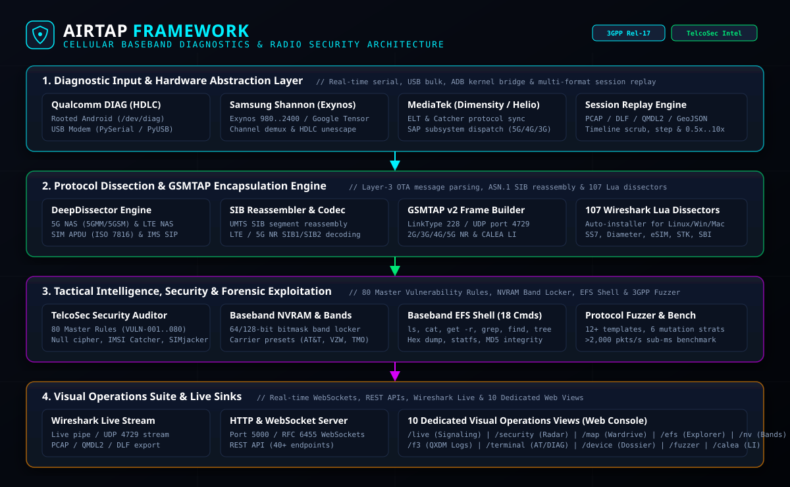
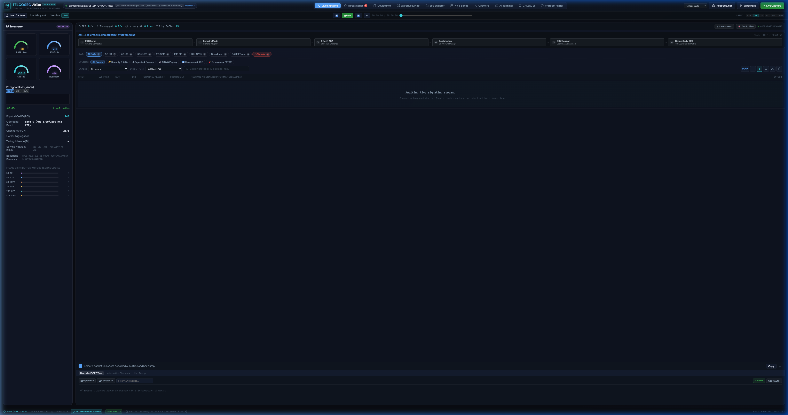
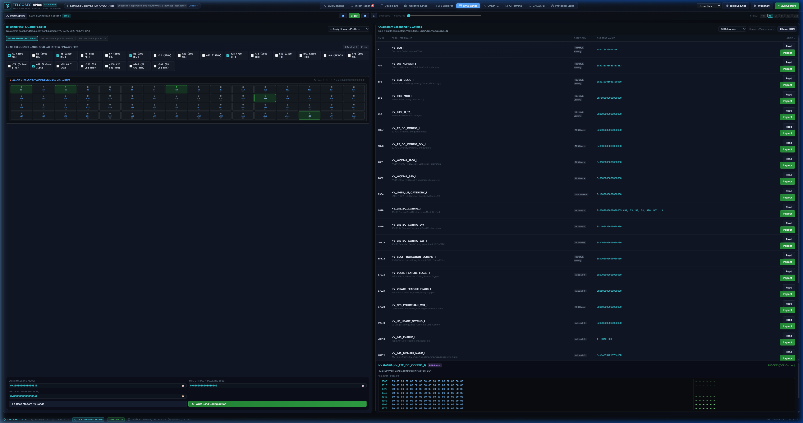
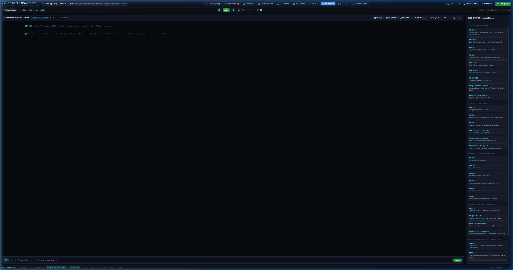
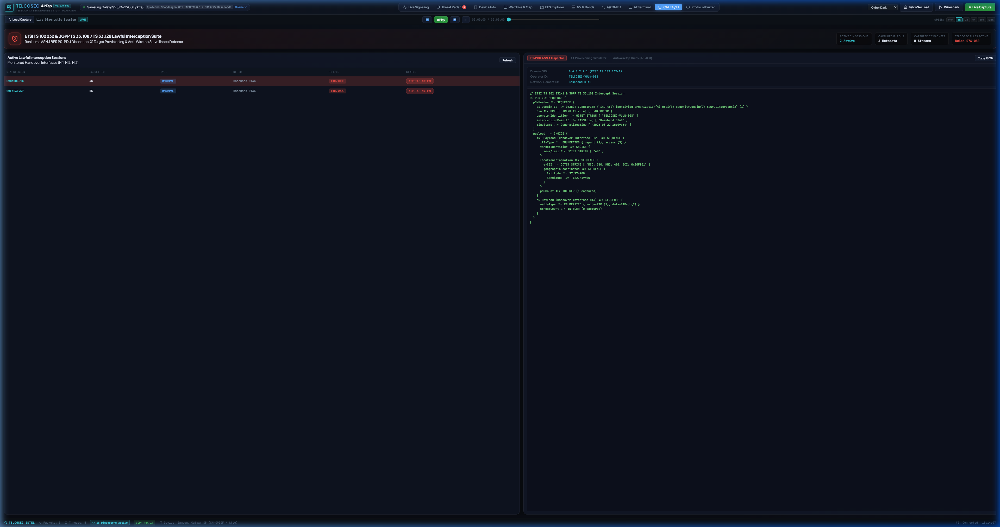
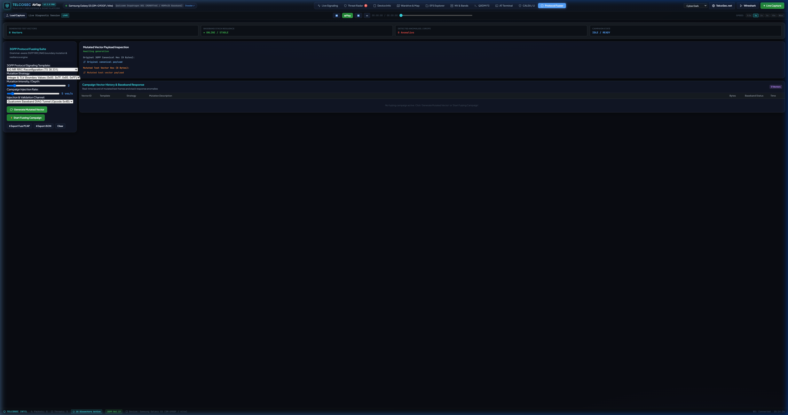

# AirTap: Cellular Radio Diagnostics & Security Framework

[](https://github.com/TelcoSec-Tools/AirTAP-Framework/actions/workflows/ci.yml)
[](https://www.python.org/)
[](LICENSE)
[](https://www.wireshark.org/)
[](https://www.3gpp.org/)
[](https://app.telcosec.net)

**AirTap** is a modular cellular radio diagnostics, packet capture, and security auditing framework. It talks directly to Qualcomm-based baseband modems over the diagnostic (DIAG) protocol and decodes raw **2G, 3G, 4G, and 5G NR** signaling in real time into standard **GSMTAP v2 PCAP** streams and **live Wireshark** sessions.

Detection is **deterministic, not probabilistic**: a pure-Python 3GPP ASN.1 UPER/PER engine decodes each protocol field at its specified offset, and 88 auditable rules evaluate those decoded values. There is no model, no training data, and no inference — every alert traces to a named field and a 3GPP clause you can verify yourself. In a tool whose output drives real security decisions, a finding you cannot reproduce is worse than no finding at all.

Alongside capture, AirTap ships an **embedded baseband security auditor**, **subscriber identity & Silent SMS dissectors**, an interactive **EFS filesystem shell**, a **baseband NVRAM band-locking studio**, a **QXDM F3 debug and event streamer**, and real-time **geospatial RF wardrive telemetry**.

---

<div align="center">
  
</div>

---

## Table of Contents

- [Key Capabilities](#key-capabilities)
- [How Detection Works](#how-detection-works)
- [Architecture Overview](#architecture-overview)
- [Supported Radio Technologies & Protocols](#supported-radio-technologies--protocols)
- [Hardware & Capture Sources](#hardware--capture-sources)
- [Installation](#installation)
- [Quick Start](#quick-start)
- [Feature Showcase](#feature-showcase)
  - [1. Visual Operations Suite (Web GUI)](#1-visual-operations-suite-web-gui)
  - [2. 3GPP ASN.1 UPER / PER / BER Dissection Engine](#2-3gpp-asn1-uper--per--ber-dissection-engine)
  - [3. Subscriber Identity & Silent SMS Protocol Suite](#3-subscriber-identity--silent-sms-protocol-suite)
  - [4. Real-Time Radio Security Auditor (88 Master Rules)](#4-real-time-radio-security-auditor-88-master-rules)
  - [5. Geospatial Cellular Wardrive & RF Heatmap](#5-geospatial-cellular-wardrive--rf-heatmap)
  - [6. Baseband NVRAM Studio & Hardware Band Locker](#6-baseband-nvram-studio--hardware-band-locker)
  - [7. Interactive EFS Filesystem Shell](#7-interactive-efs-filesystem-shell)
  - [8. APN & 5G S-NSSAI Security Testing Suite](#8-apn--5g-s-nssai-security-testing-suite)
  - [9. Wireshark Telecom Dissector Suite & C-V2X Scanner](#9-wireshark-telecom-dissector-suite--c-v2x-scanner)
- [TelcoSec Academy (Training & Labs)](#telcosec-academy--hands-on-telecom-security-training)
- [Command-Line Reference](#command-line-reference)
- [Troubleshooting](#troubleshooting)
- [Documentation](#documentation)
- [Contributing](#contributing)
- [Responsible Use & Security](#responsible-use--security)
- [License & Acknowledgements](#license--acknowledgements)

---

## ⚡ Key Capabilities

- 📡 **Real-Time 2G / 3G / 4G / 5G NR Capture**: Streams raw over-the-air radio signaling (RRC, NAS, MAC, RLC, PDCP, SIBs, SDAP) into GSMTAP v2 frames for Wireshark.
- 🛡️ **Embedded Security Auditor (88 Master Rules)**: Automated detection of IMSI catchers, null ciphering (`EEA0`/`NEA0`), null integrity (`EIA0`/`NIA0`), Silent SMS (Type 0), SIMjacker, and ETSI TS 102 232 Lawful Interception taps.
- 🧬 **Pure-Python 3GPP ASN.1 UPER / PER Engine**: Native bit-stream decoder for 5G NR SIB1..SIB19 (NTN Satellite), 4G RRC, C-V2X Sidelink Direct PC5, LPP Positioning (TS 37.355), and European eCall MSD (EN 15722).
- 🪪 **Subscriber Identity & Silent SMS Suite**: Real-time extraction of IMSI, TMSI, 4G/5G GUTI, SUCI, Type 0 Silent SMS, Flash Class 0, and SIM OTA commands.
- 🗺️ **Geospatial Wardrive & Tactical Map**: Live baseband RSRP heatmap contours, multi-sector tower triangulation, Timing Advance (TA) perimeter rings, and CALEA surveillance vectors.
- 🎛️ **Baseband NVRAM Studio & Band Locker**: Direct modem NV writing (`DIAG_NV_WRITE_F`), 5G NR band preference masks (n1..n261 mmWave), and SA/NSA mode control.
- 🖥️ **AirTap Visual Operations Suite**: Dedicated operational views (Live Signaling, Threat Radar, Identities, SMS, OTA, Wardrive Map, NV Studio, EFS Explorer, AT Terminal, Protocol Fuzzer, and CALEA LI).
- 🦈 **107+ Wireshark Lua Dissectors**: Built-in dissector suite covering 5G NR, LTE, SS7, Diameter, eSIM RSP, STK Proactive, and carrier interfaces.
- 🔌 **Multi-Vendor Diagnostic Support**: Qualcomm DIAG, Samsung Shannon (Exynos/Tensor), and MediaTek (Dimensity/Helio) trace formats.
- ⏯️ **Interactive Session Replayer**: High-precision scrubbing, stepping, and 0.5x..10x playback across PCAP, DLF, QMDL2, and GeoJSON streams.
- 💻 **Cross-Platform Support**: Works seamlessly on Linux, macOS, Windows, and WSL2 with self-healing ADB watchdog auto-reconnect.

---

## 🔍 How Detection Works

Every finding AirTap reports is reproducible from the packet bytes. The pipeline is three deterministic stages:

| Stage | What happens | Why it matters |
| :--- | :--- | :--- |
| **1. Decode** | The ASN.1 UPER/PER engine and the Lua dissectors parse each PDU into named 3GPP fields at their specified offsets. | A field is read where the spec says it lives, never searched for. |
| **2. Evaluate** | 88 rules test those decoded values (`cipheringAlgorithm == 0`, `redirectedCarrierInfo == geran`, `tp_pid == 0x40`). | Each rule is a readable condition on a named field, not a weighting. |
| **3. Report** | Alerts cite the rule ID, the field, and the 3GPP clause that defines it. | You can verify any alert against the spec and the capture. |

This is a deliberate design choice. An earlier revision matched cipher codes as substrings of a hex-dumped PDU; on measurement, **73% of ordinary release messages** tripped a `[CRITICAL]` IMSI-catcher alert. Those heuristics were replaced with positional field reads. In an auditing tool a false critical is worse than a miss, because it teaches the operator to ignore the real ones.

What this means in practice:

- 🧾 **Auditable** — every alert maps to a `TELCOSEC-VULN-###` rule and a spec clause.
- 🔁 **Reproducible** — the same capture always yields the same findings.
- 🚫 **No model, no telemetry** — nothing is uploaded, inferred, or scored; captures never leave your machine.
- 🧪 **Regression-tested** — dissectors run under a real Lua 5.3+ interpreter in CI, so a decoder that dies on the first packet fails the build instead of failing silently on live traffic.

---

## 🏗️ Architecture Overview

<div align="center">
  
</div>

```
+-----------------------------------------------------------------------------------+
|                                AirTap Architecture                               |
+-----------------------------------------------------------------------------------+
|                                                                                   |
|  [Hardware & Inputs]                                                              |
|   +-------------------+  +-------------------+  +-------------------------------+ |
|   |  Rooted Android   |  |   USB / PCIe      |  |  Remote TCP / Offline Traces  | |
|   |   (ADB /dev/diag) |  | Qualcomm Modems   |  | (TCP Socket, DLF, PCAP)    | |
|   +---------+---------+  +---------+---------+  +---------------+---------------+ |
|             |                      |                            |                 |
|             v                      v                            v                 |
|   +-----------------------------------------------------------------------------+ |
|   |                   AirTap Core Input Engine & HDLC Framer                    | |
|   |       (Thread-Safe Request/Response Dispatcher & Asynchronous Log Router)   | |
|   +-------------------------------------+---------------------------------------+ |
|                                         |                                         |
|  [Processing Modules]                   v                                         |
|   +-------------------+  +-------------------+  +-------------------------------+ |
|   |  GSMTAP Dumper    |  |  Radio Security   |  |  Diagnostic & Control Modules | |
|   |  - 2G/3G/4G/5G NR |  |  Auditor Engine   |  |  - Interactive EFS Shell      | |
|   |  - SIB Reassembly |  |  - 88 Threat Rules|  |  - NV RAM Item Manager        | |
|   |  - NAS Decrypt    |  |  - IMSI Catchers  |  |  - QXDM F3 Debug & Events     | |
|   |  - IMS/VoLTE SIP  |  |  - Silent SMS     |  |  - RF Signal Telemetry & Stats| |
|   |  - 107 Dissectors |  |  - CALEA / LI     |  |  - 3GPP Protocol Fuzzer       | |
|   +---------+---------+  +---------+---------+  +---------------+---------------+ |
|             |                      |                            |                 |
|  [Outputs]  v                      v                            v                 |
|   +-------------------+  +-------------------+  +-------------------------------+ |
|   |  Wireshark Live   |  |  Structured JSON  |  |  Interactive Terminal Shell   | |
|   |  / PCAP Capture   |  |  Threat Alerts    |  |  & Visual Web GUI             | |
|   +-------------------+  +-------------------+  +-------------------------------+ |
+-----------------------------------------------------------------------------------+
```

---

## 📶 Supported Radio Technologies & Protocols

| Technology | Supported Layers & Protocols | Advanced Features |
| :--- | :--- | :--- |
| **2G (GSM)** | Layer 3 Signaling (RR / MM / CC / SS / SMS) | Full GSMTAP L3 encapsulation |
| **2.5G (GPRS/EDGE)** | Layer 2 & 3 (MAC-RLC, LLC, SNDCP) | Control channel extraction |
| **3G (UMTS / WCDMA)**| Layer 3 (RRC, MM, GMM, CC) | SIB reassembly (`--reassemble-sibs`) |
| **4G (LTE)** | Layer 3 (RRC, EMM, ESM) | NAS deciphering (`--decrypt-nas`), ASN.1 SIB dump |
| **5G (NR)** | Layer 3 (NR-RRC, 5GMM, 5GSM) | GSMTAP v2 (`NR_RRC`, `NR_NAS`), Wireshark Lua dissectors |
| **IMS / VoLTE / VoNR** | SIP Session Signaling & Registration | Encapsulated into standard UDP port 5060 |
| **Emergency & CALEA**| ETWS, CMAS, PWS, CALEA Diagnostic Logs | PCAP, statistics, and ETSI TS 102 232 LI audit |

---

## 🔌 Hardware & Capture Sources

1. **Rooted Android Devices (Qualcomm Snapdragon)**:
   - Connect phone via USB with USB Debugging enabled.
   - Root access is required to access `/dev/diag`.
   - Native support for Linux, macOS, and Windows (including WSL2 with automated ADB forwarding).
2. **USB Modems / PCIe Dongles (Qualcomm MDM/SDX)**:
   - Any modem exposing a Qualcomm DIAG serial interface (e.g. Quectel EC25/EG25/RM500Q/RM520N, Huawei, Sierra Wireless, Telit, Fibocom).
   - Use `--usb-modem auto` for automatic port detection or specify `--usb-modem /dev/ttyUSB0` (Linux) / `COM3` (Windows).
3. **Multi-Vendor Baseband Capture Files**:
   - Samsung Shannon / Exynos (`--shannon-read <file>`) and MediaTek Dimensity/Helio (`--mtk-read <file>`).
4. **Remote TCP DIAG Service**:
   - Stream diagnostics over a network socket using `--tcp <IP>:<PORT>`.
5. **Interactive Session Replay**:
   - Replay recorded captures (`-r <file>` / `--replay <file>`) with speed control (`--replay-speed 2.0`).

---

## 📦 Installation

### From Source (Recommended)

```bash
# 1. Clone repository
git clone https://github.com/TelcoSec-Tools/AirTAP-Framework.git
cd AirTAP-Framework

# 2. (Optional) Create virtual environment
python3 -m venv .venv
source .venv/bin/activate  # On Windows: .venv\Scripts\activate

# 3. Install in editable mode
pip install -e .

# 4. Deploy 107+ Wireshark Lua Dissectors
airtap --install-plugins
```

### System Prerequisites

- **Python**: 3.8+ (tested on Python 3.8, 3.9, 3.10, 3.11, 3.12, 3.13).
- **Wireshark**: Recommended version 3.0+ for live streaming (`--wireshark-live`).
- **ADB**: Required when capturing from Android devices.

---

## 🚀 Quick Start

### 1. Launch the Visual Operations Suite (Web GUI)
```bash
# Auto-detect modem/ADB phone and launch interactive visual dashboard:
airtap --gui
# Or directly with Android ADB target:
airtap -a --gui
```

### 2. Live Stream to Wireshark (Android Phone)
```bash
# Capture directly from rooted Android phone and open Wireshark with real-time stats:
airtap -a -l -s
```

### 3. Deploy Wireshark Dissectors
```bash
# Install bundled 5G NR, 5GS NAS, SIM, and Telecom Security dissectors:
airtap --install-plugins
```

### 4. 3GPP Protocol Fuzzing Campaign
```bash
# Generate mutated 5G NR RRC vectors and export to GSMTAP PCAP:
airtap --fuzz --fuzz-template nr_rrc_reconfig --fuzz-count 20 --fuzz-pcap fuzz_5g.pcap
```

### 5. Baseband Performance & Latency Benchmark
```bash
# Stress-test dissection pipeline throughput and compute latency percentiles:
airtap --benchmark --benchmark-pkts 2000
```

### 6. Interactive Baseband AT & DIAG Terminal
```bash
# Execute single AT command or automated audit macro:
airtap -m auto --at-cmd "AT+COPS?"
airtap -m auto --at-macro full_audit
```

### 7. Run Real-Time Radio Security Audit
```bash
# Monitor cellular signaling for IMSI catchers, downgrades, and silent SMS:
airtap -a --sec-audit --audit-log audit_log.json
```

### 8. Interactive EFS Filesystem Shell
```bash
# Connect to modem EFS and start interactive navigation:
airtap -a --shell
```

---

## 🔬 Feature Showcase

### 1. Visual Operations Suite (Web GUI)
AirTap includes a built-in **Visual Operations Suite** (`airtap --gui`) powered by a high-performance local WebSocket daemon and tactical dark glassmorphic UI across 10 dedicated operational views:

| Live Signaling Stream & Attach Machine | Threat Radar (80 TelcoSec Vulnerability Rules) |
|:---:|:---:|
|  |  |

| Tactical Wardrive & Cell Tower Map | Baseband EFS Filesystem & Hex Explorer |
|:---:|:---:|
|  |  |

| NVRAM Manager & 64/128-Bit Band Locker | AT Terminal & Qualcomm DIAG Shell |
|:---:|:---:|
|  |  |

| ETSI TS 102 232 CALEA / Lawful Intercept | 3GPP Protocol Mutation & Fuzzing Engine |
|:---:|:---:|
|  |  |

### 2. 3GPP ASN.1 UPER / PER / BER Dissection Engine
AirTap incorporates a pure-Python **ASN.1 bit-stream engine** (`src/protocol/asn1_uper.py`) supporting unaligned packed encoding rules (UPER), packed encoding rules (PER), and basic encoding rules (BER) with zero native compilation dependencies:

- 🛰️ **5G NR SIB1..SIB19 (TS 38.331 Rel-15..17)**: Dissects cell selection thresholds (`q-RxLevMin`, `q-QualMin`), neighbor carrier frequencies, and **SIB19 (Satellite 5G Non-Terrestrial Networks)** orbital ephemeris & Doppler compensation vectors.
- 📡 **4G LTE RRC & Dedicated Control**: Full parsing of SIB1..SIB21, `RRCConnectionReconfiguration`, and Measurement Configurations.
- 🚗 **C-V2X Sidelink Direct RRC (PC5)**: Real-time decoding of direct vehicle-to-vehicle telematics, `sl-BWP-Config`, and autonomous resource allocations.
- 📍 **3GPP Positioning Protocol (LPP - TS 37.355)**: Decodes `ProvideAssistanceData`, `RequestLocationInformation`, and `ProvideLocationInformation` across A-GNSS, RTK, OTDOA, and PRS cellular timing measurements.
- 🚑 **Emergency eCall Minimum Set of Data (MSD - EN 15722 / ISO 24978)**: Extracts VIN (17-char ASCII), vehicle propulsion type (EV Battery, Hydrogen Fuel Cell, Gasoline, Diesel), crash sensor trigger vs. manual SOS, and WGS-84 coordinates.

### 3. Subscriber Identity & Silent SMS Protocol Suite
Deep forensic decoders for over-the-air subscriber identities and stealth signaling:

- 👤 **Subscriber Identity Extraction**: Decodes cleartext IMSI, IMEI, IMEISV, 2G/3G TMSI, P-TMSI, M-TMSI, 4G GUTI, 5G-GUTI, 5G-S-TMSI, and 5G ECIES SUCI (Profile A/B Ephemeral Public Keys) alongside USIM APDU `EF_IMSI` / `EF_MSISDN`.
- 📩 **Silent SMS & OTA Commands**: Detects and parses Type 0 Silent SMS (`PID=0x40`), Flash Class 0 immediate display (`DCS=0x10`), 7-bit GSM, UCS-2, and SIM OTA commands (`PID=0x7F` / TAR payload).
- 🌍 **Global PLMN Intelligence**: Built-in international carrier resolution dictionary (`GLOBAL_PLMN_MAP`) resolving MCC/MNC codes to carrier names and countries.

### 4. Real-Time Radio Security Auditor (88 Master Rules)
The built-in telecom vulnerability engine analyzes live signaling against **88 master security detection rules** (cataloged under `TELCOSEC-VULN-001` through `VULN-088`):

- **False Base Station / IMSI Catcher**: Detection of unencrypted OTA IMSI Identity Requests (`VULN-001`).
- **Malicious Downgrade Attacks**: Detection of forced EMM/GMM Cause #7 ("EPS services not allowed") and Cause #15 redirects (`VULN-002`, `VULN-003`).
- **Insecure Ciphering**: Alerts on LTE/5G Null Ciphering (`EEA0`/`NEA0`) and Null Integrity (`EIA0`/`NIA0`) (`VULN-004`, `VULN-005`).
- **Covert Tracking & Surveillance**: Detection of Type 0 Silent SMS (`VULN-006`) and CALEA silent modem wiretaps (`VULN-079`).
- **SIMjacker & STK Spyware**: Identifies rogue STK `SEND SHORT MESSAGE` or covert `PROVIDE LOCAL INFORMATION` IMEI/location harvesting commands (`VULN-007`–`VULN-010`, `VULN-056`–`VULN-075`).
- **Lawful Interception Tampering**: ETSI TS 102 232 unencrypted HI2/HI3 exposure, sequence counter replays, and unauthorized X1 activation (`VULN-076`–`VULN-080`).
- **Wireless & Baseband Firmware Exploits**: Detection of Broadpwn Wi-Fi SoC heap corruptions (`VULN-081`), SweynTooth/BLESA BLE link layer zero-length packet freezes (`VULN-082`), BrakTooth LMP crashes (`VULN-083`), KNOB key entropy reduction (`VULN-084`), Bluetooth Mesh unencrypted provisioning (`VULN-085`), Cellular-Wi-Fi CoEx starvation (`VULN-086`), VoWiFi IPsec weak crypto (`VULN-087`), and Baseband PCIe/UART DMA host memory escape attempts (`VULN-088`).

```bash
airtap -a --sec-audit --audit-log report.json
```

### 5. Geospatial Cellular Wardrive & RF Heatmap
The interactive geospatial suite (`#tab-map`) visualizes cellular radio topography in real time:

- 🗺️ **Live RSRP Coverage Heatmap**: Dynamic color-coded signal quality contours (> -85 dBm Excellent, -85..-95 Good, -95..-105 Fair, < -105 Poor).
- 🗼 **Multi-Sector Cell Tower Triangulation**: Computes base station locations and draws directional radiation azimuth wedges (0°, 120°, 240° with 30° offsets) using the Log-Distance Path Loss Model.
- ⭕ **Timing Advance (TA) Physical Distance Rings**: 3GPP TS 36.213 / 38.213 distance perimeter circles (`TA * 78.12m`) around serving cell towers.
- ⚠️ **Geolocated Threat Pins & Surveillance Vectors**: Places red pulsing danger zones when rogue base stations or lawful interception vectors are detected.
- 💾 **Multi-Format Geospatial Export**: Export drive-tests to Google Earth 3D KML (`/api/geo/export?format=kml`), GeoJSON Features (`format=geojson`), and WiGLE / OpenCellID CSV (`format=wigle`).

### 6. Baseband NVRAM Studio & Hardware Band Locker
Read, modify, and analyze Qualcomm Non-Volatile (NV) RAM memory items directly over DIAG:

- 🔒 **Hardware 5G NR & LTE Band Lock**: Write band preference masks targeting `NV_NR5G_BAND_PREF_I` (NV #71502) and `NV_LTE_BC_CONFIG_I` (NV #6828) across n1..n261 mmWave and B1..B64.
- ⚡ **5G SA / NSA Mode Control**: Toggle 5G Standalone (`NV_NR5G_SA_ENABLE_I` #71500) and Non-Standalone EN-DC (`NV_NR5G_NSA_ENABLE_I` #71501).
- 📞 **VoLTE / VoNR IMS Stack Config**: Enable or audit IMS registration profiles (`NV_IMS_ENABLE_I` #70210).

```bash
# Read specific NV item:
airtap -a --nv-read 6828

# Dump common modem NV items:
airtap -a --nv-dump ./nv_backup
```

### 7. Interactive EFS Filesystem Shell
Explore and manipulate Qualcomm modem NV items and configuration files stored in the baseband EFS2 filesystem:

```bash
airtap -a --shell
```
Available shell commands:
- `ls [path]`: List directory entries with permissions and file types.
- `cat <file>`: Display content of an EFS file.
- `get [-r] <remote_path> [local_path]`: Download files or entire directory trees.
- `put <local_path> <remote_path>`: Upload a local file to modem EFS.
- `find <path> -name <pattern>`: Search files matching regex/wildcards.
- `grep <pattern> <file>`: Search for text inside EFS files.
- `md5sum <file>`: Calculate MD5 checksum of an EFS file directly on modem.
- `statfs`: Show total and available EFS filesystem blocks.
- `tree [path]`: Visual hierarchical tree of directory structure.

### 8. APN & 5G S-NSSAI Security Testing Suite
Audit mobile APN configurations and 5G network slicing against 3GPP TS 23.003, TS 23.401, TS 23.501, and GSMA PRD IR.88 / FS.31 specifications:

- 🔒 **APN Restriction Enforcement**: Audits 3GPP APN Restriction levels (0-4) to prevent cross-bearer isolation leakage on IMS, SOS, and enterprise networks.
- 📡 **Carrier Profile Intelligence**: Deep profiles for VoLTE/VoNR IMS SIP, Emergency SOS, Ut/XCAP self-care, MMS, Tethering, and FOTA management.
- 🌐 **Dual-Stack IPv6 Verification**: Enforces GSMA IR.92 mandates to prevent CGNAT subscriber tracking.
- 🕵️ **Rogue Proxy & MitM Detection**: Identifies malicious static HTTP/WAP proxy injections, DNS poisoning, and unencrypted transport leaks.
- ⚡ **5G S-NSSAI Slice Mapping**: Verifies Slice Service Types (SST: eMBB, URLLC, MIoT, V2X) and Slice Differentiator (SD) compliance.

```bash
# Audit standard carrier APN profile:
airtap --apn-audit "ims.mnc020.mcc310.gprs" --apn-restr 4

# Test custom/enterprise APN with static proxy or IPv4:
airtap --apn-audit "enterprise.data" --apn-pdp "IPv4" --apn-proxy "192.168.1.1:8080"
```

### 9. Wireshark Telecom Dissector Suite & C-V2X Scanner
AirTap is fully integrated with the open-source **[TelcoSec Wireshark Dissectors](https://github.com/TelcoSec-Tools/TelcoSec_Wireshark_Dissectors)** ecosystem, featuring 70+ specialized Lua protocol analyzers:

- 🚗 **C-V2X & ProSe Sidelink (PC5) Scanner**: Real-time dissection of V2X safety messages (CAM, DENM, BSM, SPAT), IEEE 1609.2 security certificates, and Ghost Vehicle spoofing detection.
- 📡 **5G NR / LTE / GSM-GPRS Air Interface**: Deep dissectors for RRC, NAS-5GS, EMM/ESM, ML1, MAC/RLC/PDCP, and SIB broadcasts.
- 💳 **SIM & Smart Card Security**: Real-time decoding of UICC APDUs, STK proactive commands, BIP exfiltration, and AKA challenge-response vectors.
- 🕵️ **ETSI TS 102 232 Lawful Interception**: Automatic detection and deep dissection of HI2/HI3 packet streams, CIN tracking, and plaintext intercept leakage.

```bash
# Auto-deploy all dissectors into your system's Wireshark plugins directory:
airtap --install-plugins
```

Explore the standalone dissector repository: **[github.com/TelcoSec-Tools/TelcoSec_Wireshark_Dissectors ↗](https://github.com/TelcoSec-Tools/TelcoSec_Wireshark_Dissectors)**

---

## TelcoSec Academy — Hands-On Telecom Security Training

Master cellular radio security, 5G NR architecture, IMSI catcher analysis, SIM security, and baseband protocol exploitation with interactive cloud labs and certified training at **[TelcoSec Academy (app.telcosec.net)](https://app.telcosec.net)**:

- 📡 **Hands-On Cellular Defense**: Deep dive into over-the-air signaling vulnerabilities across 2G, 3G, 4G, and 5G Standalone.
- 🔬 **Baseband & Protocol Forensics**: Practical analysis of Qualcomm DIAG, Samsung Shannon, and MediaTek ELT logs.
- 🛡 **88 Master Vulnerability Rules**: Step-by-step walkthroughs of attack vectors from IMSI harvesting to ETSI TS 102 232 lawful interception auditing and wireless baseband exploits.
- 🎓 **Telecom Cybersecurity Certification**: Industry-recognized skill validations for telecom engineers, penetration testers, and security researchers.

👉 **[Launch Interactive Labs at app.telcosec.net ↗](https://app.telcosec.net)**

---

## ⌨️ Command-Line Reference

```text
Usage: airtap [INPUT] [OUTPUT/MODULES] [OPTIONS]

Inputs (choose one or auto-detect):
  -a, --adb                     Connect via ADB to a rooted Android device
  -m, --usb-modem [PORT]        Connect to USB modem (e.g. 'auto', '/dev/ttyUSB0', 'COM3')
  -t, --tcp IP:PORT             Connect to remote TCP Diag service (e.g. 127.0.0.1:2500)
  -r, --replay FILE             Replay an existing capture file (.pcap, .dlf, .json)
  --shannon-read FILE           Read Samsung Shannon / Exynos baseband trace
  --mtk-read FILE               Read MediaTek baseband trace
  -w, --adb-wsl2 [ADB_PATH]     Connect to Android device via WSL2 ADB bridge

Outputs & Modules:
  -g, --gui                     Launch the AirTap Visual Operations Suite (Web GUI)
  -l, --wireshark-live          Open Wireshark and stream captured packets live
  -s, --stats                   Display real-time packet statistics & RF telemetry
  -o, --pcap FILE               Save captured GSMTAP radio frames to PCAP file
  -q, --qmdl FILE               Write packets to Qualcomm .qmdl container
  --sec-audit                   Enable real-time Radio Security Auditor (88 rules)
  --audit-log FILE              Save structured security audit alerts to JSON
  --install-plugins             Deploy Wireshark Lua dissectors to plugin dir
  --benchmark                   Execute dissection throughput & latency benchmark
  --fuzz                        Execute 3GPP protocol fuzzing campaign
  --at-cmd CMD                  Execute single AT / DIAG command on modem
  --at-macro NAME               Execute automated diagnostic macro sequence
  --shell                       Launch interactive modem EFS filesystem shell
  --info                        Query modem firmware revision, model & chip ID
  --decoded-sibs-dump           Display ASN.1 decoded System Information Blocks (SIBs)
  --dump-fs DIR                 Dump modem EFS filesystem to local directory
  --nv-read ITEM_ID             Read and display a Qualcomm NV item
  --nv-dump DIR                 Dump common modem NV items to directory
  --messages, --f3              Stream internal baseband F3 debug messages
  --events                      Stream asynchronous modem events

Capture Tuning:
  --reassemble-sibs             Reassemble segmented 3G/4G SIBs before encapsulation
  --decrypt-nas                 Attempt LTE NAS deciphering using extracted keys
  --include-ip                  Include user-plane IP traffic in capture
  --filter-rat RATS             Filter capture to specific RATs (e.g. '4g,5g', '2g')
  --filter-logs CODES           Filter capture to specific log codes (e.g. '0xb0c0,0xb0cd')
  -v, --verbose                 Enable verbose debug logging
  --version                     Show AirTap version and exit
```

---

## 🧰 Troubleshooting

### Android ADB Connection
- **"Device unauthorized or offline"**: Run `adb devices` and accept the authorization prompt on the phone screen.
- **"Permission denied on /dev/diag"**: The Android device must be rooted. Run `adb root` or verify root permissions in Magisk/KernelSU.
- **SELinux blocking access**: Run `adb shell su -c setenforce 0` to set SELinux to permissive mode for diagnostics.

### USB Modem Access
- **Serial Port Permissions (Linux)**: Add your user to the `dialout` group: `sudo usermod -aG dialout $USER`.
- **Modem in Wrong Mode**: Verify the modem exposes a DIAG interface (e.g. via `lsusb` or `dmesg`). Some modems require sending `AT+QCFG="usbnet"` or similar AT configuration commands to enable DIAG.

### Wireshark Lua Dissector Integration
AirTap automatically configures and loads its custom Lua dissectors for 5G NR RRC and 5GS NAS. If Wireshark warns about disabled Lua scripts, ensure `enable_lua = true` in your Wireshark `init.lua` settings.

---

## 📚 Documentation

Full documentation lives in [`docs/wiki/`](docs/wiki/Home.md) — installation, capture
sources, the GUI, CLI reference, security auditing, dissectors, architecture and
troubleshooting.

| | | |
| :--- | :--- | :--- |
| [Installation](docs/wiki/Installation.md) | [Quick Start](docs/wiki/Quick-Start.md) | [Capture Sources](docs/wiki/Capture-Sources.md) |
| [Visual Operations Suite](docs/wiki/Visual-Operations-Suite.md) | [CLI Reference](docs/wiki/CLI-Reference.md) | [Security Auditing](docs/wiki/Security-Auditing.md) |
| [Wireshark Dissectors](docs/wiki/Wireshark-Dissectors.md) | [EFS & NV Tools](docs/wiki/EFS-and-NV-Tools.md) | [Architecture](docs/wiki/Architecture.md) |
| [Troubleshooting](docs/wiki/Troubleshooting.md) | [FAQ](docs/wiki/FAQ.md) | [Contributing](docs/wiki/Contributing.md) |

---

## 🤝 Contributing

We welcome contributions from the telecommunications and cybersecurity community! Please check out [CONTRIBUTING.md](CONTRIBUTING.md) for development setup, testing procedures, and submission guidelines.

---

## ⚖️ Responsible Use & Security

AirTap is designed for research, educational purposes, network auditing, and authorized telecommunications diagnostics. Capturing radio signaling may expose sensitive subscriber identifiers (IMSI, IMEI) and location information. Use AirTap only on networks and devices you own or are explicitly authorized to test.

### Do not expose the Web GUI to a network

The Visual Operations Suite (`--gui`) binds to `127.0.0.1` and **has no authentication**. That is deliberate: it is a local operator console, not a multi-user service. Its API can write persistent baseband NVRAM (`/api/nv/write`), execute AT and raw Diag commands (`/api/terminal/exec`, `/api/terminal/diag_raw`), read the modem filesystem, and stream live captured signaling.

Anyone who can reach the port has all of that, unauthenticated. Do not bind it to `0.0.0.0`, forward the port, or place it behind a reverse proxy without adding your own authentication and TLS in front. Requests from other web origins are rejected, so a page you visit while AirTap is running cannot drive the API, but that guard does not substitute for network isolation.

For vulnerability disclosure guidelines, please read our [Security Policy](SECURITY.md).

---

## 📄 License & Acknowledgements

AirTap is free and open-source software licensed under the **GNU General Public License v3.0**. The full license text is available in [LICENSE](LICENSE).

Open-source telecom ecosystem:
- **Osmocom Project** (GSMTAP specification and tooling)
- **Wireshark** (Protocol dissection and Lua engine)
- **SnoopSnitch / gsm-parser** (Radio analysis and protocol definitions)
- **MobileInsight & SCAT** (Cellular diagnostics research)
- **Pycrate** (ASN.1 runtime compiler and 3GPP codecs)
