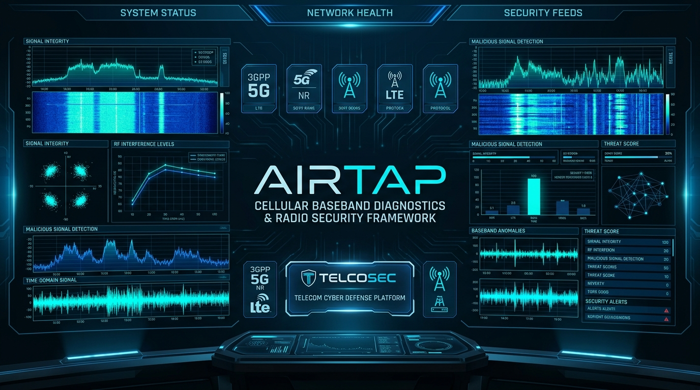
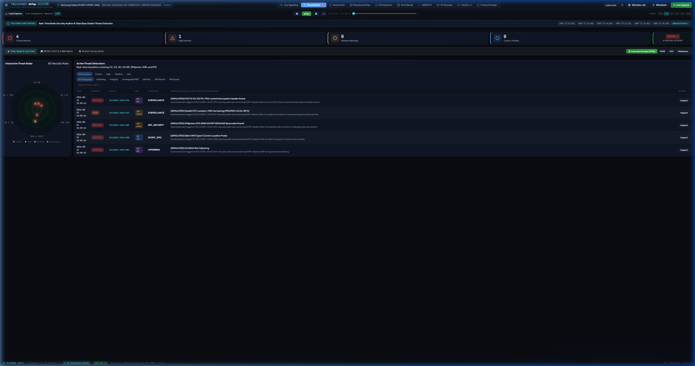
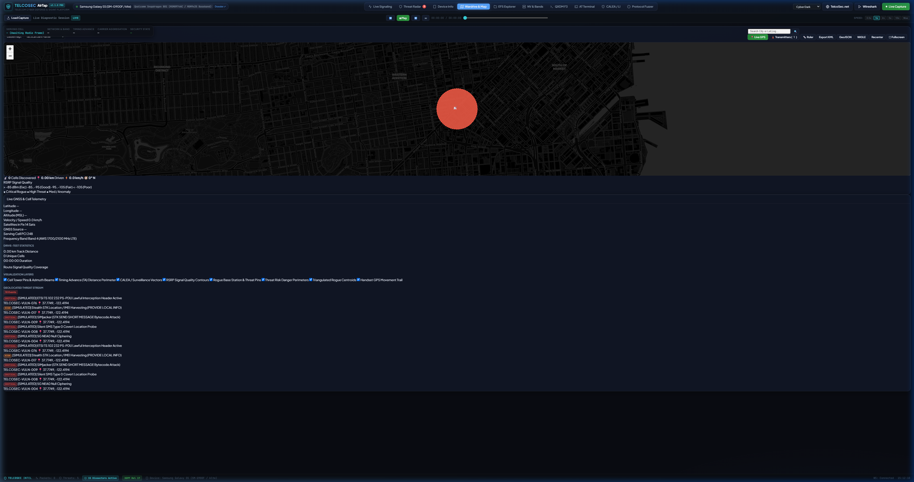
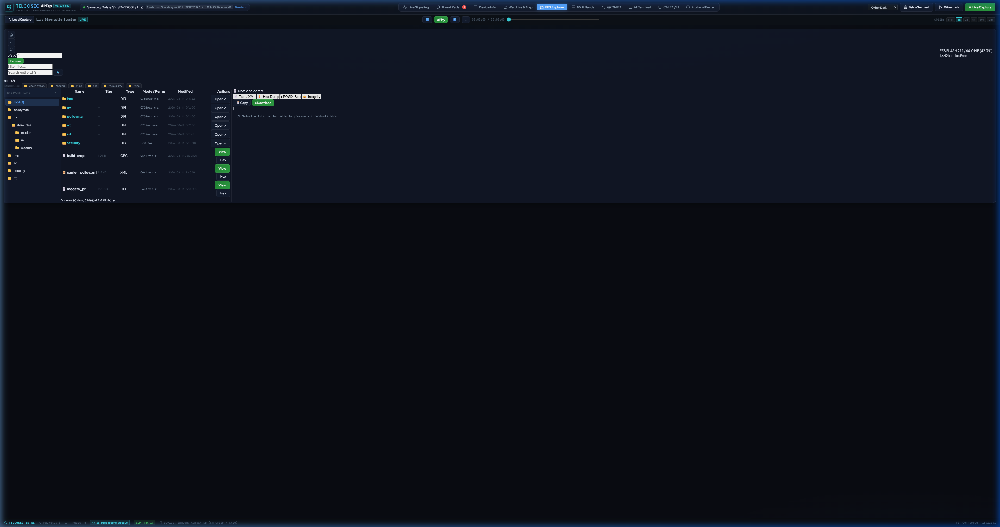

# AirTap: Cellular Radio Diagnostics & Security Framework

[](https://github.com/TelcoSec-Tools/AirTAP-Framework/actions/workflows/ci.yml)
[](https://www.python.org/)
[](LICENSE)
[](https://www.wireshark.org/)
[](https://www.3gpp.org/)
[](https://github.com/TelcoSec-Tools/AirTAP-Framework/wiki)
[](https://app.telcosec.net)

**AirTap** is a modular cellular radio diagnostics, packet capture, and security auditing framework. It talks directly to Qualcomm-based baseband modems over the diagnostic (DIAG) protocol and decodes raw **2G, 3G, 4G, and 5G NR** signaling in real time into standard **GSMTAP v2 PCAP** streams and **live Wireshark** sessions.

Detection is **deterministic, not probabilistic**: a pure-Python 3GPP ASN.1 UPER/PER engine decodes each protocol field at its specified offset, and 88 auditable rules evaluate those decoded values. There is no model, no training data, and no inference — every alert traces to a named field and a 3GPP clause you can verify yourself. In a tool whose output drives real security decisions, a finding you cannot reproduce is worse than no finding at all.

<div align="center">
  
</div>

---

## 📚 Documentation

Full documentation is in the **[Wiki](https://github.com/TelcoSec-Tools/AirTAP-Framework/wiki)**.

| | | |
| :--- | :--- | :--- |
| [Installation](https://github.com/TelcoSec-Tools/AirTAP-Framework/wiki/Installation) | [Quick Start](https://github.com/TelcoSec-Tools/AirTAP-Framework/wiki/Quick-Start) | [Capture Sources](https://github.com/TelcoSec-Tools/AirTAP-Framework/wiki/Capture-Sources) |
| [Visual Operations Suite](https://github.com/TelcoSec-Tools/AirTAP-Framework/wiki/Visual-Operations-Suite) | [CLI Reference](https://github.com/TelcoSec-Tools/AirTAP-Framework/wiki/CLI-Reference) | [Security Auditing](https://github.com/TelcoSec-Tools/AirTAP-Framework/wiki/Security-Auditing) |
| [Wireshark Dissectors](https://github.com/TelcoSec-Tools/AirTAP-Framework/wiki/Wireshark-Dissectors) | [EFS & NV Tools](https://github.com/TelcoSec-Tools/AirTAP-Framework/wiki/EFS-and-NV-Tools) | [Architecture](https://github.com/TelcoSec-Tools/AirTAP-Framework/wiki/Architecture) |
| [Troubleshooting](https://github.com/TelcoSec-Tools/AirTAP-Framework/wiki/Troubleshooting) | [FAQ](https://github.com/TelcoSec-Tools/AirTAP-Framework/wiki/FAQ) | [Contributing](https://github.com/TelcoSec-Tools/AirTAP-Framework/wiki/Contributing) |

---

## ⚡ Key Capabilities

- 📡 **Real-time 2G/3G/4G/5G NR capture** — raw over-the-air signaling (RRC, NAS, MAC, RLC, PDCP, SIBs, SDAP) into GSMTAP v2 for Wireshark.
- 🛡️ **Security auditor, 88 rules** — IMSI catchers, null ciphering (`EEA0`/`NEA0`), null integrity (`EIA0`/`NIA0`), Silent SMS (Type 0), SIMjacker, ETSI TS 102 232 lawful interception.
- 🧬 **Pure-Python 3GPP ASN.1 UPER/PER engine** — 5G NR SIB1..SIB19 (incl. NTN satellite), 4G RRC, C-V2X PC5, LPP positioning, eCall MSD.
- 🪪 **Subscriber identity & SMS suite** — IMSI, TMSI, 4G/5G GUTI, SUCI, Silent SMS, Flash Class 0, SIM OTA.
- 🗺️ **Geospatial wardrive & tactical map** — RSRP heatmaps, tower triangulation, timing-advance rings, threat pins.
- 🎛️ **Baseband NVRAM studio & band locker** — NV read/write, 5G NR band masks (n1..n261), SA/NSA control.
- 🖥️ **Visual Operations Suite** — web GUI with twelve operational views.
- 🦈 **107 Wireshark Lua dissectors** — 5G NR, LTE, SS7, Diameter, eSIM RSP, STK, carrier interfaces.
- 🔌 **Multi-vendor** — Qualcomm DIAG live; Samsung Shannon and MediaTek trace decoding.
- ⏯️ **Session replay** — scrub, step and replay PCAP, DLF, QMDL2 and GeoJSON at 0.5×–10×.

---

## 🔍 How Detection Works

| Stage | What happens | Why it matters |
| :--- | :--- | :--- |
| **1. Decode** | The ASN.1 engine and Lua dissectors parse each PDU into named 3GPP fields at their specified offsets. | A field is read where the spec says it lives, never searched for. |
| **2. Evaluate** | 88 rules test those decoded values (`cipheringAlgorithm == 0`, `redirectedCarrierInfo == geran`, `tp_pid == 0x40`). | Each rule is a readable condition on a named field, not a weighting. |
| **3. Report** | Alerts cite the rule ID, the field, and the 3GPP clause that defines it. | Any alert can be verified against the spec and the capture. |

This is deliberate. An earlier revision matched cipher codes as substrings of a hex-dumped PDU; on measurement, **73% of ordinary release messages** tripped a `[CRITICAL]` IMSI-catcher alert. Those heuristics were replaced with positional field reads. In an auditing tool a false critical is worse than a miss, because it teaches the operator to ignore the real ones.

→ [Security Auditing](https://github.com/TelcoSec-Tools/AirTAP-Framework/wiki/Security-Auditing)

---

## 🚀 Quick Start

```bash
pip install -e .
airtap --install-plugins        # deploy the 107 Wireshark dissectors

airtap -l -s                    # live capture into Wireshark + telemetry
airtap -o capture.pcap          # record to GSMTAP PCAP
airtap --gui                    # Visual Operations Suite (127.0.0.1:5000)
airtap --sec-audit -s           # run the 88-rule auditor
airtap -r capture.pcap --gui    # replay a capture, no hardware needed
```

No hardware? Replay a bundled sample:

```bash
airtap -r docs/sample_pcaps/sample_2g_3g_4g_xperia.pcap -s
```

→ [Installation](https://github.com/TelcoSec-Tools/AirTAP-Framework/wiki/Installation) ·
[Quick Start](https://github.com/TelcoSec-Tools/AirTAP-Framework/wiki/Quick-Start) ·
[CLI Reference](https://github.com/TelcoSec-Tools/AirTAP-Framework/wiki/CLI-Reference)

---

## 🖥️ Visual Operations Suite

| | |
| :--- | :--- |
|  |  |
| **Live Signaling** — real-time frame feed, RAT breakdown, RF telemetry | **Threat Radar** — the 88-rule catalogue with live trigger counts |
|  |  |
| **Wardrive & Map** — RSRP heatmap, tower triangulation, threat pins | **EFS Explorer** — browse and extract the modem filesystem |

Twelve tabs in total, including Device Info, QXDM F3 Logs, NV & Bands, SIM & Keys, AT Terminal, CALEA/LI and the Protocol Fuzzer.

→ [Visual Operations Suite](https://github.com/TelcoSec-Tools/AirTAP-Framework/wiki/Visual-Operations-Suite)

---

## 📶 Supported Radio Technologies

| Technology | Layers & Protocols | Notable |
| :--- | :--- | :--- |
| **2G (GSM)** | L3 (RR / MM / CC / SS / SMS) | Full GSMTAP L3 encapsulation |
| **2.5G (GPRS/EDGE)** | L2 & L3 (MAC-RLC, LLC, SNDCP) | Control channel extraction |
| **3G (UMTS/WCDMA)** | L3 (RRC, MM, GMM, CC) | SIB reassembly |
| **4G (LTE)** | L3 (RRC, EMM, ESM) | NAS deciphering, ASN.1 SIB dump |
| **5G (NR)** | L3 (NR-RRC, 5GMM, 5GSM) | GSMTAP v2 `NR_RRC` / `NR_NAS` |
| **IMS / VoLTE / VoNR** | SIP session signaling | Encapsulated on UDP 5060 |
| **Emergency & CALEA** | ETWS, CMAS, PWS, LI logs | ETSI TS 102 232 audit |

Capture sources: rooted Android (ADB), USB/PCIe Qualcomm modems, remote TCP DIAG, and
offline trace replay.
→ [Capture Sources](https://github.com/TelcoSec-Tools/AirTAP-Framework/wiki/Capture-Sources)

---

## 🎓 TelcoSec Academy

Hands-on cellular security training with interactive cloud labs at
**[app.telcosec.net](https://app.telcosec.net)** — over-the-air signaling attacks across
2G–5G SA, baseband and protocol forensics, walkthroughs of the 88 vulnerability rules,
and telecom cybersecurity certification.

---

## ⚖️ Responsible Use & Security

AirTap is for research, education, network auditing, and **authorized** telecommunications
diagnostics. Capturing radio signaling exposes subscriber identifiers (IMSI, IMEI) and
location data. Use it only on networks and devices you own or are explicitly authorized
to test.

**Do not expose the Web GUI to a network.** It binds to `127.0.0.1` and **has no
authentication** by design — it is a local operator console. Its API can write persistent
baseband NVRAM, execute AT and raw DIAG commands, read the modem filesystem, and stream
live signaling. Anyone who can reach the port has all of that. Requests from other web
origins are rejected, but that is not a substitute for network isolation.

Vulnerability disclosure: [SECURITY.md](SECURITY.md).

---

## 🤝 Contributing

Contributions are welcome — see [CONTRIBUTING.md](CONTRIBUTING.md) and the
[Contributing wiki page](https://github.com/TelcoSec-Tools/AirTAP-Framework/wiki/Contributing)
for development setup, testing and conventions.

---

## 📄 License & Acknowledgements

Free and open-source software under the **GNU General Public License v3.0**
([LICENSE](LICENSE)).

Built on the open-source telecom ecosystem: **[QCSuper](https://github.com/P1sec/QCSuper)**
(the project AirTap derives from), **Osmocom** (GSMTAP), **Wireshark** (dissection and the
Lua engine), **SnoopSnitch / gsm-parser**, **MobileInsight & SCAT**, and **Pycrate**
(ASN.1 codecs).
